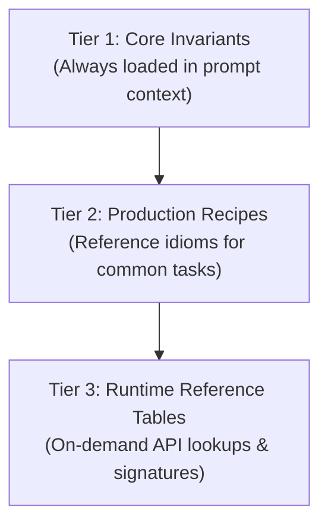
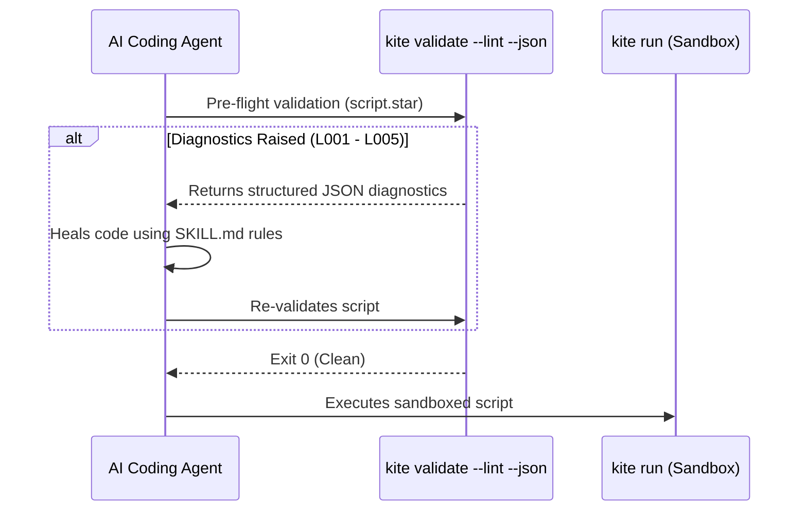

# Agent Skills & Tool Integration

When autonomous AI coding agents (such as Claude Code, Cursor, Antigravity, or Robo) write and execute infrastructure automation, they require clear operational boundaries, deterministic execution rules, and accurate API signatures.

Starkite provides built-in agent skill generation through `kite doc --skills`. Rather than requiring developers to manually write prompts or ingest large API manuals, Starkite reflects directly against its live Go runtime catalog to produce standardized `SKILL.md` documents formatted with 3-tier progressive disclosure.

---

## 1. The 3-Tier Progressive Disclosure Model

Starkite skills are structured into three distinct tiers to maximize LLM context efficiency and prevent prompt pollution:



### Tier 1: Core Language Invariants
Injected into the agent's initial system prompt or context window. Contains five load-bearing rules that eliminate the most common LLM syntax and runtime errors:
1. **Automatic Entrypoint Execution**: Scripts define entry logic inside `def main():` or `def main(ctx):`. Calling `main()` manually at the top level causes duplicate execution and corrupts exit status codes.
2. **`try_` Result Pattern**: Functions interacting with system resources provide safe `try_*` variants (e.g. `fs.try_read_text`, `os.try_exec`, `http.try_get`) returning status fields (`res.ok`, `res.value`, `res.error`, `res.code`).
3. **Kernel Sandbox Isolation**: Scripts execute within OS-level sandboxes (Landlock LSM on Linux, Seatbelt on macOS, AppContainers on Windows).
4. **Auto-Loaded Standard Modules**: Standard modules (`fs`, `os`, `http`, `json`, `yaml`, `concur`, `k8s`) are pre-declared globals; agents must not write `import fs` or `load("fs", ...)`.
5. **Starlark Native String Methods**: String manipulation is native to `str` instances (`s.split()`, `s.startswith()`, `s.strip()`, `sep.join()`).

### Tier 2: Scripting Idioms & Recipes
Provides copy-pasteable, verified patterns for common operations: safe subprocess execution with argument vectors (`os.try_exec`), JSON/YAML conversions, concurrent endpoint probing (`concur.map`), and Kubernetes resource inspection.

### Tier 3: Complete Runtime Reference Tables
Exhaustive markdown tables generated directly from the Go type catalog detailing every module member, parameter signature, return type, docstring, and safe `try_*` equivalent.

---

## 2. Generating Skills with the CLI

The `kite doc` command generates skill documents for different automation scopes:

```bash
# Generate the unified Starkite automation skill (all core modules)
kite doc --skills > .agent/skills/starkite/SKILL.md

# Generate a category-scoped skill (e.g., cloud, k8s, sys, data)
kite doc --skills --category=cloud > .agent/skills/starkite-cloud/SKILL.md

# Generate a targeted single-module skill (e.g., k8s, http, os)
kite doc k8s --skills > .agent/skills/starkite-k8s/SKILL.md
```

### Automated Distribution via `project-starkite/skills`
Official skill definitions are automatically synchronized with every Starkite release to the [project-starkite/skills](https://github.com/project-starkite/skills) repository. Agents can install them directly:

```bash
npx skills add project-starkite/skills
```

---

## 3. The Closed-Loop Agent Self-Correction Workflow

Starkite enables agents to self-heal scripts prior to execution using the dialect linter:



### Pre-Flight Linting Example
When an agent authors a script, it runs:

```bash
kite validate --lint --json deploy.star
```

If the agent made a mistake (such as calling `main()` at the top level or omitting `res.ok` validation), `kite validate` emits structured JSON diagnostics:

```json
{
  "code": "L001",
  "line": 15,
  "column": 1,
  "message": "top-level call to main() prevents automatic runtime discovery",
  "severity": "warning"
}
```

The agent reads the diagnostic, corrects the code, and re-validates before executing the script under the sandbox.

---

## 4. Starkite as an Agent's Default Operational Tool

AI coding agents often rely on ad-hoc shell one-liners (`bash`, `awk`, `sed`, `python -c`) for repository triage, log inspection, and multi-file audits. Starkite provides a safer, deterministic alternative:

### Fast Inline Evaluations with `kite eval`
Eliminates the overhead of writing temporary scratch files:

```bash
# Inspect and transform JSON without Python boilerplate
kite eval '
data = json.decode(os.exec("gh", ["run", "list", "--json", "status,conclusion"]))
failed = [r for r in data if r.get("conclusion") == "failure"]
print("Detected %d failed workflow runs" % len(failed))
'
```

### Deterministic Subprocess Execution
Unlike raw shell execution, Starkite invokes processes using explicit argument vectors (`argv`), completely preventing shell word-splitting and command injection:

```python
res = os.try_exec("git", ["diff", "--name-only", "HEAD~1"])
if res.ok:
    for file in res.stdout.strip().split("\n"):
        log.info("Modified file: %s" % file)
```

### Guaranteed Sandbox Safety
Scripts executed via `kite run` or `kite eval` run under kernel sandbox confinement (Landlock/Seatbelt/AppContainers). Agents cannot accidentally modify sensitive system locations or initiate unauthorized outbound network connections unless granted explicit capabilities.
