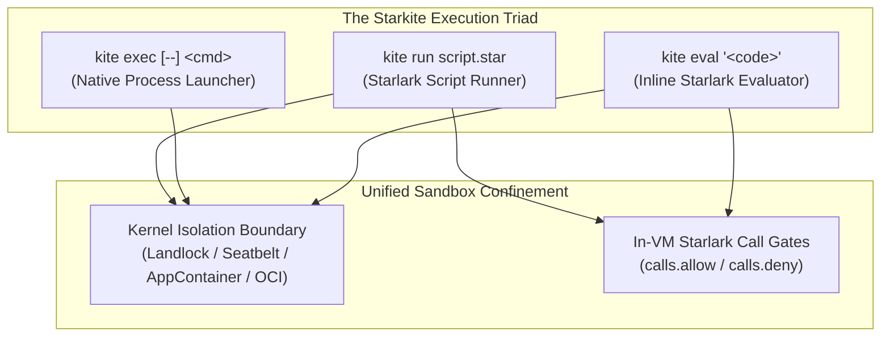

# Execution Sandbox & Security Architecture

Starkite enforces zero-trust execution by default. Every script executed via `kite run` or `kite eval`, and every external command launched via `kite exec`, runs inside an operating system kernel boundary and Starlark capability gate under the `deny-all` profile. Confined workloads are isolated from host credentials, unauthorized filesystems, network egress, and ambient host environment variables.

---

## 1. Zero-Trust Default Confinement

When you invoke Starkite, execution sandboxing engages automatically (`--sandbox-enabled=true`). You do not need to pass an opt-in flag to secure script execution or native process launches.

Under the default `deny-all` profile, Starkite guarantees the following runtime invariants:

- **Network Egress Blocked**: Sockets and network namespaces are restricted (`network: none`). Outbound network requests fail closed at the kernel level.
- **Filesystem & Working Directory Confinement**: Neither the current working directory (`$CWD`) nor the user's home directory (`$HOME`) are mounted into the sandbox. Workloads run with an isolated `rw,noexec` temporary scratch directory mounted at `/tmp` (`HOME=/tmp`, `TMPDIR=/tmp`).
- **Subprocess Execution Lockdown**: Process spawning is disabled (`exec.deny: ["*"]`, `no_exec: true`). Attempts to execute binaries on the host are blocked by kernel filters.
- **Environment Sanitization**: Ambient host environment variables are scrubbed. The workload receives only a minimal, safe baseline (`PATH`, `HOME=/tmp`, `TMPDIR=/tmp`, `LANG=C.UTF-8`, `TERM`).
- **Memory-Resident Closures**: Local `.star` files and modules loaded via top-level `load()` statements are resolved, parsed, and cached in memory before sandbox boundary lock down, allowing modular scripts to execute without requiring filesystem mount permissions.

---

## 2. Sandboxing and the Execution Triad

Starkite provides three distinct execution entry points governed by the sandbox:



1. **`kite run <script.star>`**: Executes Starlark scripts under dual-layer defense: the OS kernel boundary blocks unauthorized syscalls, while Starlark call gates validate API operations in memory before reaching the operating system.
2. **`kite exec [--] <command>`**: Directly launches native host processes inside the OS kernel sandbox. It bypasses the Starlark VM entirely, forwarding command-line arguments, streaming standard I/O, propagating exit codes, and enforcing kernel isolation with zero runtime overhead. Starlark call gates (`--sandbox-call-*`) do not apply to native binaries.
3. **`kite eval '<code>'`**: Evaluates inline Starlark expressions under the zero-trust `deny-all` profile, ideal for testing expressions and verifying module outputs.

---

## 3. Supported Sandbox Drivers

Starkite isolates processes using native operating system primitives or container runtimes:

| Driver | Platform | Kernel Isolation Mechanism | Execution Model |
| :--- | :--- | :--- | :--- |
| `landlock` | Linux | Unprivileged Landlock LSM syscalls (`landlock_create_ruleset`) and Classic Seccomp-BPF socket/process filters | In-process (zero subprocess overhead) |
| `seatbelt` | macOS | Dynamic Seatbelt binding (`sandbox_init` with compiled Scheme SBPL profiles) | In-process (zero subprocess overhead) |
| `windows` | Windows | AppContainer token isolation, Win32 Job Object limits, NTFS DACLs, and WFP socket filtering | Process-isolation (broker / worker) |
| `podman` | Linux, macOS, Windows | Rootless OCI container with automatic path bind mounts | Subprocess container overhead |
| `docker` | Linux, macOS, Windows | Ephemeral Docker container execution | Subprocess container overhead |
| `nerdctl` | Linux, macOS | Ephemeral containerd runtime execution | Subprocess container overhead |
| `gvisor` | Linux | Application kernel sandboxing via `runsc` (Sentry) | Container / MicroVM overhead |

When invoked without an explicit `--sandbox-driver`, Starkite auto-detects the host driver: `landlock` on Linux, `seatbelt` on macOS, `windows` on Windows, or an available container runtime.

---

## 4. Built-in Capability Ladder

Privileges are organized into a five-rung capability ladder, where each profile is a strict superset of the prior:

| Profile | Network | Filesystem (`$CWD`) | Subprocess Execution | Primary Purpose |
| :--- | :--- | :--- | :--- | :--- |
| `deny-all` (default) | `none` | Isolated (`[]`) | Blocked (`no_exec: true`) | Pure computation, print, and log. Top-level `load()` closures are pre-loaded in memory. |
| `sandbox-path` | `none` | `$CWD` read/write, `/tmp` scratch | Blocked (`no_exec: true`) | Local file processing, code generation, and SQLite databases within the working directory. |
| `sandbox-exec` | `none` | `$CWD` read/write, `/tmp` scratch | Allowed (`exec.allow: ["*"]`) | Running local build tools, compilers, and CLI utilities without network access. |
| `sandbox-net` | `host` | `$CWD` read/write, `/tmp` scratch + DNS/TLS certs | Allowed (`exec.allow: ["*"]`) | Full cloud-native workflows (`http`, `ssh`, `k8s`, `mcp`, `containers`). |
| `unconfined` | `host` | Unrestricted host filesystem | Unrestricted | Completely disables OS sandbox confinement and Starlark permission checks (`--sandbox-enabled=false`). |

Select a profile with `--sandbox-profile=<name>`:

```bash
kite run ./calc.star                                       # Runs under default 'deny-all'
kite run ./process_files.star --sandbox-profile=sandbox-path
kite run ./build_project.star --sandbox-profile=sandbox-exec
kite run ./deploy_stack.star --sandbox-profile=sandbox-net
kite run ./untrusted.star --sandbox-enabled=false         # Disables sandbox (runs unconfined)
```

---

## 5. Filesystem Mounts and Scratch Storage

For workflows requiring explicit host-to-sandbox path mappings, third-party package dependencies, or temporary in-memory scratch storage, Starkite provides the first-class `--sandbox-mount` flag. Mounts are enforced directly by the active kernel sandbox driver (`landlock`, `seatbelt`, `windows`, or OCI containers).

### Mount Syntax

The `--sandbox-mount` flag is repeatable and supports three formats:

1. **Full Bind Mount**: `<source>:<destination>[:<mode>]`  
   Maps a host `<source>` directory or file to an absolute `<destination>` inside the sandbox. Relative host paths resolve against `$CWD`; `~` and `$HOME` expand against the user's home directory. Mode defaults to read-only (`ro`); pass `rw` for read-write access.
   ```bash
   kite exec --sandbox-mount ./data:/app/data:ro -- app
   kite exec --sandbox-mount /var/log:/var/log:rw -- app
   ```

2. **Identity Bind Mount**: `<source>[:<mode>]`  
   Maps `<source>` to the identical destination path inside the sandbox. Mode defaults to `ro`. Bare relative paths (e.g. `node_modules` or `.venv`) automatically resolve against `$CWD`.
   ```bash
   kite exec --sandbox-mount /opt/custom-tools:ro -- tool
   kite exec --sandbox-mount .venv:ro --env PYTHONPATH=.venv -- python3 script.py
   kite exec --sandbox-mount /tmp/build-cache:rw -- build-tool
   ```

3. **In-Memory Tmpfs Mount**: `tmpfs:<destination>[:<mode>]`  
   Mounts an isolated in-memory scratch filesystem at `<destination>` with default mode `rw`. Ideal for build outputs, scratch work, and compiler intermediate files.
   ```bash
   kite exec --sandbox-mount tmpfs:/scratch -- make
   ```

Windows paths with drive letters are volume-aware:
```powershell
kite exec --sandbox-mount C:\data:C:\app\data:ro -- app.exe
kite exec --sandbox-mount tmpfs:C:\scratch -- build.exe
```

### Interpreter & Dependency Recipes

Starkite provides explicit, unopinionated recipes for common language runtimes without requiring hardcoded language profiles:

#### Python Virtual Environments
Execute a Python script with its associated virtual environment:
```bash
kite exec --sandbox-mount .venv:ro --env PYTHONPATH=.venv -- python3 script.py
# Or using path read:
kite exec --sandbox-path-read=.venv --env PYTHONPATH=.venv -- python3 script.py
```

#### Node.js Modules
Run a Node.js application accessing project modules:
```bash
kite exec --sandbox-mount node_modules:ro -- node app.js
# Or using path read:
kite exec --sandbox-path-read=node_modules -- node app.js
```

#### Ephemeral Scratch Builds
Run compilation steps in an isolated in-memory scratch workspace:
```bash
kite exec --sandbox-mount tmpfs:/scratch -- sh -c "echo ok > /scratch/out"
```

---

## 6. Composable CLI Capability Flags

Rather than switching whole profiles, you can selectively grant specific capabilities from the command line on top of the zero-trust default:

| CLI Flag | Description |
| :--- | :--- |
| `--sandbox-mount=<spec>` | Mounts a host path or tmpfs scratch directory into the sandbox (`<source>[:<dest>[:ro\|rw]]` or `tmpfs:<dest>`) (repeatable). |
| `--sandbox-path-read=<path>` | Grants read access to a specific host path (repeatable). Paths with literal commas are preserved verbatim. |
| `--sandbox-path-write=<path>` | Grants read and write access to a specific host path (repeatable). Paths with literal commas are preserved verbatim. |
| `--sandbox-exec-allow=<bins>` | Permits execution of specific binary names, absolute paths, or `*` (comma-separated or repeatable). |
| `--sandbox-exec-deny=<bins>` | Denies execution of specific binaries (takes precedence over allow rules). |
| `--sandbox-call-allow=<rules>` | Permits specific Starlark API module calls (e.g. `fs.read`, `http.client`) (repeatable). |
| `--sandbox-call-deny=<rules>` | Denies specific Starlark API module calls (repeatable). |
| `--sandbox-net-allow[=<target>]` | Grants outbound network access to endpoint(s), or `*` / bare flag for unrestricted host networking. |
| `--sandbox-net-deny[=<target>]` | Denies outbound network access to endpoint(s), or `*` / bare flag for complete air-gapping. |
| `--sandbox-net-mode=<mode>` | Selects network confinement mode (`host`, `loopback`, `none`). |
| `--sandbox-max-memory=<limit>` | Sets maximum memory ceiling for sandboxed process (e.g. `512MB`, `2GB`). |
| `--sandbox-driver=<driver>` | Selects the sandbox driver (`landlock`, `seatbelt`, `windows`, `podman`, `docker`, `nerdctl`, `gvisor`, `auto`). |
| `--sandbox-image=<image>` | Specifies the OCI image when using a container sandbox driver. |
| `--sandbox-enabled=false` | Disables sandbox confinement and runs unconfined. |

Example compositions:

```bash
# Grant working directory read/write access
kite run ./generate.star --sandbox-path-write=.

# Grant specific CLI tools and network egress
kite run ./deploy.star --sandbox-exec-allow=kubectl,helm --sandbox-net-allow

# Grant working directory read and selective outbound HTTP
kite run ./fetch.star --sandbox-path-read=. --sandbox-net-allow=api.github.com:443
```

### Runtime Usability Automations

Starkite eliminates common sandbox friction through automated runtime analysis:

1. **Static AST `load()` Closure Pre-Loading**: Local `.star` scripts referenced by top-level `load()` statements are discovered, parsed, and cached in memory before the sandbox boundary is locked down. Scripts can import helper libraries and modules without needing filesystem read grants for `$CWD`.
2. **Automatic Binary & Symlink Unveiling**: When you specify allowed binaries via `--sandbox-exec-allow=kubectl,go`, Starkite searches `$PATH`, resolves symlink chains (such as package manager links in `/opt/homebrew` or `/usr/local`), and mounts the underlying binary and its required directories read-only without exposing unauthorized paths.
3. **Automatic Network Resolution Assets**: When you enable network access (`--sandbox-net-allow` or `network: host`), the sandbox automatically unveils system DNS resolvers and TLS CA certificate bundles (`/etc/resolv.conf`, `/etc/hosts`, `/etc/ssl/certs`, `/etc/ca-certificates`, and macOS `/private/etc/ssl`).

---

## 7. Environment Isolation & Forwarding

Starkite sanitizes the process environment so host secrets cannot leak into scripts or subprocesses. You control environment variable visibility using a 3-tier synthesis model:

1. **Selective Host Forwarding**: Forward an ambient variable from the host environment:
   ```bash
   kite run ./deploy.star --env KUBECONFIG -e AWS_REGION
   ```
2. **Explicit Assignment**: Inject specific key-value pairs without reading the host environment:
   ```bash
   kite run ./deploy.star --env DEPLOY_ENV=production -e REPLICAS=5
   ```
3. **Full Host Inheritance**: Forward the complete ambient host environment when required:
   ```bash
   kite run ./local_tool.star --env-inherit
   ```

---

## 8. Custom Profiles in `config.yaml`

Define reusable sandbox profiles in `~/.starkite/config.yaml` or `./config.yaml`:

```yaml
# ~/.starkite/config.yaml
sandbox:
  # Default overrides applied when no profile is explicitly passed
  default:
    paths:
      read: ["."]

  # Deployment profile for cloud automation
  deploy:
    network:
      mode: host
      allow: ["api.github.com:443", "*.internal.net"]
    paths:
      read: ["."]
      write: ["./build", "./dist"]
    mounts:
      - source: ./data
        destination: /app/data
        mode: ro
    exec:
      allow: ["kubectl", "helm"]
    calls:
      allow: ["k8s.write", "http.client"]
    env:
      KUBECONFIG:
      DEPLOY_STAGE: production

  # Strictly isolated compute profile
  isolated:
    network: none
    paths:
      read: ["/data/readonly"]
    no_exec: true
    max_memory: "512MB"
    timeout: "60s"
```

Activate a configured profile using `--sandbox-profile`:

```bash
kite run ./deploy.star --sandbox-profile=deploy
```

### Profile Inheritance & Composition

Custom profiles can inherit from built-in profiles using `base`. Appended rules extend base capabilities, and `deny` rules always take precedence:

```yaml
# ~/.starkite/config.yaml
sandbox:
  custom-ci:
    base: sandbox-path
    network: host
    calls:
      allow: ["k8s.write"]
      deny: ["fs.delete"]
```

---

## 9. In-VM Starlark Call Gates (`calls.allow` / `calls.deny`)

In addition to OS kernel containment, Starkite evaluates Starlark API operations in-memory before syscalls reach the host operating system.

### Synthesizing Call Rules from Sandbox Settings

High-level sandbox settings automatically synthesize corresponding Starlark API gates:
- `paths.read`: Automatically authorizes `fs.read` for permitted paths.
- `paths.write`: Automatically authorizes `fs.read`, `fs.write`, and `fs.delete` for permitted paths.
- `exec.allow` / `exec.deny`: Automatically generates `os.exec` allow and deny rules.
- `network.allow` / `network: host`: Automatically authorizes network operations across `http.client`, `http.server`, `ssh`, `k8s`, and `mcp`.

### Fine-Grained Rule Grammar

For surgical function- or resource-level authorization, configure `calls.allow` and `calls.deny` in `config.yaml` or pass `--sandbox-call-allow` / `--sandbox-call-deny`:

`module.category[([function_list:]resource)]`

- **module**: Target module name (`fs`, `os`, `http`, `ssh`, `k8s`, `sql`, `mcp`, `io`).
- **category**: Target category name (`read`, `write`, `exec`, `client`, `server`, `connect`).
- **function_list**: Optional comma-separated list of function names.
- **resource**: Optional path, host pattern, or glob.

### Common Rule Patterns

| Pattern | Matches |
| :--- | :--- |
| `*.*` | Any module, category, and operation |
| `fs.*` | Any operation in the `fs` module |
| `fs.read` | Any read operation in the `fs` module on any path |
| `fs.read($CWD/**)` | Read operations on paths matching `$CWD/**` |
| `fs.read(read_file:*)` | Only the `read_file` function on any path |
| `http.client(*.example.com:443)` | Outbound HTTP requests targeting `*.example.com` on port 443 |
| `os.exec($CWD/**)` | Execution of any binary located under `$CWD` |

Evaluation is **deny-first**. Any operation not explicitly matched by an allow rule (or matching a deny rule) is denied.

### Checked Modules

| Module | Categories | Operations Checked |
| :--- | :--- | :--- |
| `fs` | `read`, `write`, `delete` | File/directory reads, writes, and deletions |
| `os` | `exec`, `shell`, `env`, `process` | Process execution, shell calls, env access, signal delivery |
| `http` | `client`, `server` | Outbound HTTP requests, listening HTTP servers |
| `ssh` | `connect`, `transfer` | Remote SSH execution, file uploads/downloads (SCP) |
| `k8s` | `read`, `write`, `exec`, `config` | Cluster reads/writes, pod exec, kubeconfig loading |
| `sql` | `open` | Database connections (scoped by driver, e.g. `sqlite`, `postgres`) |
| `mcp` | `client`, `server` | MCP connections and hosting |
| `io` | `prompt` | Terminal user prompts |

Pure-compute modules (`strings`, `math`, `yaml`, `json`, `time`, `base64`, `hash`, `gzip`, `zip`) bypass call checks.

---

## 10. Module Trust Boundaries (`mod.yaml`)

When you import an external module using `load()`, it executes under the calling script's active sandbox profile. Loading third-party code does not expand sandbox boundaries.

Furthermore, third-party modules declaring required capabilities in `mod.yaml` must not exceed operator grants. If a module's declared requirements exceed the active profile, execution halts before code runs:

```bash
$ kite run ./app.star
Error: module "acme/netmod" requires capabilities exceeding active profile "default":
  - network: host (active: none)
  Hint: rerun with required capabilities: kite run --sandbox-net-allow ./app.star
```

---

## 11. POSIX Identity Switching

On POSIX platforms, Starkite supports executing commands under specified user or group credentials by passing `userid` and `groupid` to process execution functions (`os.exec(..., userid=1001, groupid=1001)`).

Because identity switching is a sensitive operation, it requires the `unconfined` profile or an explicit `switch_identity` grant:

```yaml
sandbox:
  deploy:
    calls:
      allow:
        - os.exec(switch_identity:/usr/bin/git)
```

---

## 12. Actionable Denial Diagnostics & Telemetry

When an operation is prohibited by the sandbox or call gate, Starkite formats an actionable diagnostic error indicating the exact CLI flag or configuration setting required:

```text
Error: script error: permission denied: fs.read read_file("./config.yaml") - no matching allow rule
  grant "fs.read" with --sandbox-profile=sandbox-path (or higher), or in the sandbox: section of config.yaml
  Hint: pass --sandbox-path-read=. on CLI, or add "." to sandbox.<profile>.paths.read in config.yaml
```

```text
Error: script error: permission denied: os.exec exec("/usr/bin/kubectl") - blocked by deny rule: os.exec
  Hint: pass --sandbox-exec-allow=kubectl on CLI, or add "kubectl" to sandbox.<profile>.exec.allow in config.yaml
```

### Process Execution Diagnostics (`kite exec`)

When launching external processes with `kite exec`, Starkite inspects child exit codes and standard error to diagnose kernel sandbox denials versus application dependency failures:

- **Python Missing Modules**: If Python fails with `ModuleNotFoundError: No module named '<name>'`:
  ```text
  Hint: grant access to dependencies via --sandbox-path-read=<path> or --sandbox-mount <host-path>:<target-path>:ro
  ```
- **Node.js Missing Modules**: If Node.js terminates with `Error: Cannot find module '<name>'`:
  ```text
  Hint: grant access to dependencies via --sandbox-path-read=node_modules or --sandbox-mount <host-path>:<target-path>:ro
  ```
- **Ruby Missing Gems**: If Ruby terminates with `LoadError: cannot load such file -- <name>`:
  ```text
  Hint: grant access to dependencies via --sandbox-path-read=<path> or --sandbox-mount <host-path>:<target-path>:ro
  ```
- **Dynamic Linker Failures**: When an executable fails due to an unmounted shared library:
  ```text
  Hint: grant read access to library location via --sandbox-path-read=<dir>
  ```
- **Network Failures**: When network connectivity fails under an isolated profile:
  ```text
  Hint: pass --sandbox-net-allow on CLI, or add endpoint to sandbox.<profile>.network.allow in config.yaml
  ```

Under `--debug`, `kite exec` emits structured telemetry reporting duration, exit status, and active driver:
```text
[telemetry] command="python3 test.py" exit_code=0 duration=42.1ms timed_out=false driver=seatbelt
```

---

## 13. Security Invariants

Starkite sandbox drivers enforce core kernel-level invariants across all execution profiles:

### Write-XOR-Execute ($W\oplus X$)
All writable mount locations—including `$CWD`, `/tmp`, and custom writable paths—are mounted with `noexec` flags. A script cannot generate a binary or script inside a writable directory and execute it as a child process.

### Subprocess Execution Lockdown
When running under profiles where `no_exec: true` is active (`deny-all`, `sandbox-path`), process execution syscalls (`SYS_EXECVE`/`SYS_EXECVEAT` in Linux Seccomp-BPF and `process-exec` in macOS Seatbelt) are trapped and blocked at the kernel boundary.

### Shared Memory & IPC Isolation
Host shared memory segments (`/dev/shm`, `/run/shm`) and System V IPC primitives are isolated. Container drivers run with `--ipc=private`, and Linux Landlock excludes shared memory devices from sandbox rulesets.

### Process Inspection & Signal Boundary
Linux Seccomp-BPF filters prevent sandboxed processes from inspecting or modifying host processes (`SYS_PTRACE`, `SYS_PROCESS_VM_READV`, `SYS_PROCESS_VM_WRITEV`) and restrict signal delivery (`SYS_KILL`) strictly to processes within the sandbox process tree.

### Windows AppContainer & Job Object Isolation
On Windows, Starkite isolates processes using five coordinated Win32 kernel primitives:
- **Win32 Job Objects**: Enforces `JOB_OBJECT_LIMIT_KILL_ON_JOB_CLOSE` for process tree termination on exit, alongside memory ceilings, CPU quotas, and UI isolation (`JOB_OBJECT_UILIMIT_ALL`).
- **Ephemeral AppContainer Profiles**: Derives a scoped AppContainer security identifier (`S-1-15-2-...`) for the session, executing child processes in an unprivileged execution context.
- **NTFS Discretionary Access Control (DACL)**: Surgically unmasks only the script file and explicit mount targets, leaving parent directories, `%USERPROFILE%`, and host credentials inaccessible.
- **Write-XOR-Execute ($W\oplus X$) Enforcement**: Temporary scratch directories grant read and write permissions while explicitly denying `FILE_EXECUTE` in a single DACL transaction.
- **Process Mitigations & WFP**: Blocks unauthorized subprocess creation when execution is disallowed and enforces network isolation through Windows Filtering Platform socket filters.

---

## 14. Programmatic Sandbox Module (`sandbox.*`)

Starkite scripts can programmatically configure and spawn child sandboxes using the built-in `sandbox` module:

```python
# Configure a sandboxed execution environment
box = sandbox.config(
    driver="auto",
    network="host",
    no_exec=False,
    allowed_exec_paths=["/bin/echo"],
    mounts=[
        {"source": ".", "destination": "/workspace", "mode": "rw"},
    ],
    timeout="30s",
)

# Run a subprocess within the configured sandbox
result = box.exec("echo", ["hello-from-sandbox"])
if result.ok:
    print(result.stdout)
```

### Non-Escalation Security Invariant

When running inside an active parent sandbox, child sandboxes created via `sandbox.config` or `sandbox.run_script` cannot elevate privileges beyond the parent boundary. The runtime enforces an intersection rule:

$$\text{Effective Capabilities} = \text{Parent Capabilities} \cap \text{Requested Capabilities}$$

If the parent sandbox has `network: none`, child sandboxes cannot request `network: host`.
