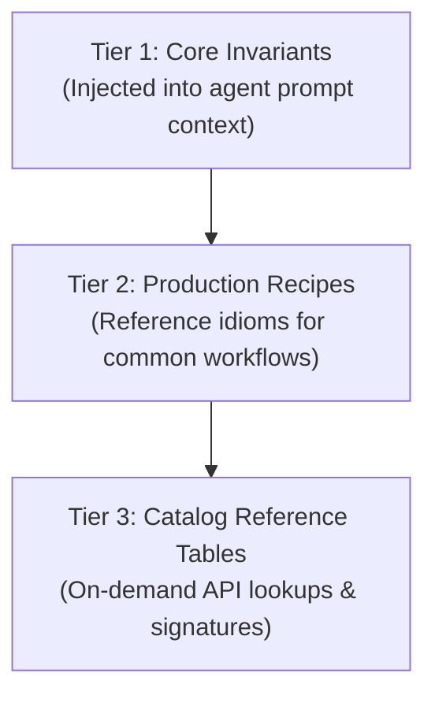

# Starkite Agent Skills & Operational Tooling Examples

This directory demonstrates how autonomous AI coding agents (Claude Code, Cursor, Antigravity, Robo) use Starkite skill definitions to author idiomatic automation scripts, execute closed-loop self-correction, and adopt Starkite as their primary operational tool.

---

## 1. Starkite Skills Architecture

Starkite skills are built directly from the runtime's Go type catalog via `kite doc --skills` and structured using **3-Tier Progressive Disclosure**:



### The Three Tiers
* **Tier 1 (Core Language Invariants)**: Compact execution constraints that fit within the agent's initial prompt context window. Teaches the agent five load-bearing rules:
  1. Entrypoint is `def main():` or `def main(ctx):` (never call `main()` at top level).
  2. Always verify `res.ok` before accessing `res.value` when using safe `try_*` functions.
  3. Scripts execute inside kernel sandboxes (Landlock, Seatbelt, AppContainers).
  4. Standard modules (`fs`, `os`, `http`, `json`, `yaml`, `concur`, `k8s`) are pre-declared globals (never write `import fs`).
  5. Starlark string methods are native to `str` instances (`s.split()`, `s.startswith()`, `s.strip()`, `sep.join()`).
* **Tier 2 (Production Recipes)**: Verified patterns for file traversal, argv command execution without shell injection, JSON-to-YAML pipelines, and concurrency.
* **Tier 3 (Catalog Reference Tables)**: Complete markdown signature tables with parameter names, types, return types, and descriptions.

### Generating and Distributing Skills
```bash
# Generate unified automation skill
kite doc --skills > .agent/skills/starkite/SKILL.md

# Generate cloud category skill
kite doc --skills --category=cloud > .agent/skills/starkite-cloud/SKILL.md

# Generate Kubernetes module skill
kite doc k8s --skills > .agent/skills/starkite-k8s/SKILL.md
```

Skills are published with every release to [project-starkite/skills](https://github.com/project-starkite/skills) and can be installed via:
```bash
npx skills add project-starkite/skills
```

---

## 2. Integrating Skills with AI Coding Agents

When configuring an AI coding agent (e.g. in `.cursorrules`, `.claudecode/rules`, or agent system prompts), reference the generated skill file:

### Agent System Prompt Pattern
```text
You are an autonomous DevOps assistant. When automating cloud infrastructure,
repository triage, or system tasks, author and execute Starkite Starlark scripts.
Always follow the core invariants defined in .agent/skills/starkite/SKILL.md:
- Place logic in def main(): and do NOT call main() at top level.
- Check res.ok before reading res.value on try_* functions.
- Use native string methods (e.g. line.split(",")).
```

### The Closed-Loop Agent Self-Correction Workflow
Before executing a generated script, the agent runs the dialect linter:

```bash
kite validate --lint --json ./deploy.star
```

If the agent made a mistake (such as calling `main()` or accessing an unchecked `try_` result), the command exits with code `1` and emits structured JSON diagnostics:

```json
[
  {
    "file": "./deploy.star",
    "line": 15,
    "column": 1,
    "code": "L001",
    "message": "top-level call to main() prevents automatic runtime discovery",
    "severity": "warning"
  }
]
```

The agent parses the diagnostic JSON, removes the top-level `main()` call as instructed by the `L001` remediation rule, and re-validates. Once validation exits `0`, the agent proceeds to sandboxed execution (`kite run ./deploy.star`).

---

## 3. Turning Starkite into an Agent's Default Operational Tool

AI coding agents often default to composing fragile shell one-liners (`bash`, `awk`, `sed`, `python -c`) for ad-hoc inspection and automation tasks. Adopting Starkite as the agent's primary operational tool provides three decisive advantages:

| Risk in Raw Shell | Starkite Advantage |
| :--- | :--- |
| **Command Injection**: Unquoted `$VAR` or arbitrary shell strings cause command injection vulnerabilities. | **Safe Argv Vectors**: `os.try_exec("git", ["diff", "--name-only"])` passes explicit argument arrays without shell expansion. |
| **Ambient Filesystem Access**: Rogue or buggy agent scripts can delete or overwrite system files. | **Kernel Sandboxing**: Default zero-trust isolation (Seatbelt, Landlock, AppContainers) bounds file writes to the script directory. |
| **Platform Inconsistency**: Bash scripts fail on Windows runners; PowerShell scripts fail on Linux. | **Hermetic Portability**: The same `.star` script runs identically across Linux, macOS, and Windows. |

### Fast Inline Execution with `kite eval`
For quick one-off inspections, agents use `kite eval "<code>"` to eliminate temporary file overhead:

```bash
# Parse GitHub release information without jq or Python imports
kite eval '
runs = json.decode(os.exec("gh", ["run", "list", "--json", "databaseId,conclusion", "-L", "5"]))
failures = [r["databaseId"] for r in runs if r["conclusion"] == "failure"]
print("Failed run IDs: %s" % failures)
'
```

---

## 4. Running the Companion Scripts

This directory includes two production-grade scripts that adhere to all Tier 1 invariants:

### 1. `workspace_audit.star`
Audits repository status, categorizes modified vs untracked files, and inspects directory composition:
```bash
kite run ./examples/skills/workspace_audit.star
```

### 2. `cloud_health_check.star`
Demonstrates concurrent fan-out endpoint probing with worker pool rate limiting:
```bash
kite run ./examples/skills/cloud_health_check.star
```
